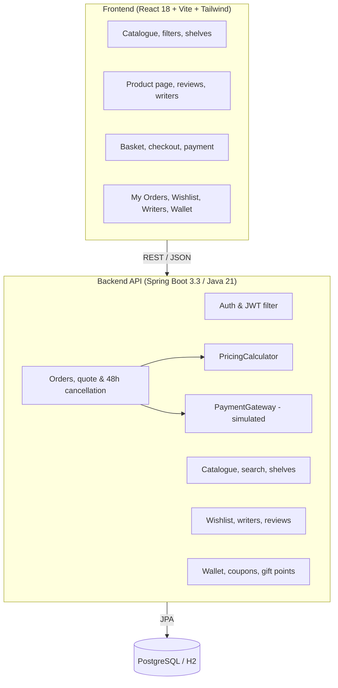

# Book Worm — E-Bookstore Platform (AI Specialist Cloud FullStack Capstone)

An online bookstore: browse by genre and brand, read about a book and its writer, fill a basket, pay with a card, UPI or wallet,
redeem gift points and coupons, and cancel any order within 48 hours. Built with an agentic IDE (IBM Bob) for the
IBM AI Specialist capstone. Prices are in Indian rupees (₹).

---

## What is in it

- **Catalogue**: genre sidebar, search, language / format / price filters, sort, publisher filter, and Recommended / Bestsellers / New Launches shelves.
- **Product page**: delivery date, Add to Cart / Add to Wishlist, language, rating, copies sold, about the writer (with Follow), reviews, Related Reads.
- **My Orders, My Wishlist, My Writers** pages.
- **Checkout**: address form, coupon, gift points, server-priced Grand Total, and Credit / Debit / UPI / Wallet payment (simulated gateway).
- **Rules**: 12% tax, free delivery from ₹499, 1 gift point = ₹1, 1 point earned per ₹100, 48-hour cancellation with refund.
- **API**: contract-first [OpenAPI 3.0](docs/openapi.yaml) (37 operations) with Swagger UI at `/api/v1/swagger-ui.html`.
- **Stack**: Spring Boot 3.3 (Java 21), JWT, JPA, PostgreSQL or H2; React 18, Vite, Tailwind CSS.
- **Ops**: Dockerfiles, `docker-compose.yml`, OpenShift (ROKS / ROSA) manifests.

> Payments are simulated. No real money moves, and card numbers, expiry and CVV are never stored.

---

## Architecture



---

## Quick start (no database needed)

The default profile uses an in-memory **H2** database that is seeded on every start.

```powershell
# Terminal 1: API on http://localhost:8080/api/v1
cd backend
./mvnw spring-boot:run

# Terminal 2: UI on http://localhost:5173
cd frontend
npm install
npm run dev
```

Demo account: **alex.dev@ibm.com / Password123!** (the sign-in dialog has a **Use demo account** button).
It starts with 250 gift points and ₹1,500 in the wallet.

Test cards: `4242 4242 4242 4242` succeeds, `4000 0000 0000 0002` is declined. Use any future expiry and any 3-digit CVV.
Coupons: `WELCOME10`, `BOOKS100`, `CLOUD20`.

## Run with PostgreSQL (Docker)

```powershell
docker compose up --build
```

- UI: http://localhost:3000
- API: http://localhost:8080/api/v1 · Swagger: http://localhost:8080/api/v1/swagger-ui.html

Credentials come from `POSTGRES_USER`, `POSTGRES_PASSWORD` and `JWT_SECRET` in your environment or a local `.env` file;
the defaults in `docker-compose.yml` are for a local demo only. The PostgreSQL profile uses its own idempotent scripts in
`backend/src/main/resources/db/postgres/`. They are written to be safe to re-run (`IF NOT EXISTS`, `ON CONFLICT DO NOTHING`) and never drop tables.

> The PostgreSQL scripts and the compose / OpenShift files were checked for syntax and idempotency but have not been run
> against a live PostgreSQL server, Docker or a cluster from this repository. See the report for details.

## Tests

```powershell
cd backend
./mvnw test        # 40 tests, including a full-stack API test on the real schema and seed data
```

Import [`docs/bookstore-api-collection.json`](docs/bookstore-api-collection.json) into Postman or Insomnia for the 36 API requests.

---

## Documentation

- [Submission report & video script](SUBMISSION_REPORT.md)
- [OpenAPI 3.0 specification](docs/openapi.yaml)
- [Data model & business rules](docs/data-model.md)
- [Agentic IDE workflow journal](docs/agentic-ide-workflow.md)
- [Docker Compose](docker-compose.yml) · [OpenShift manifest](deploy/k8s/bookstore-roks-deployment.yaml)
