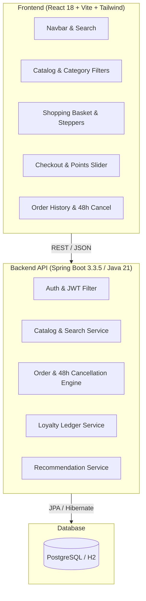

# E-Bookstore Platform — AI Specialist Cloud FullStack Capstone

> **AI-Augmented Cloud Full-Stack Solution for Bookstore eCommerce**, designed and synthesized using the **IBM Bob** Agentic IDE.

---

## 🌟 Key Features & Deliverables

- **12 Customer Journey Nodes**: Home, Authentication, Catalog, Category Filtering, Brand Browsing, Tentative Delivery Dates, Related Recommendations, Shopping Basket, Delivery Address Book, Payment Options, Loyalty Gift Points Redemption, and 48-Hour Order Cancellation.
- **Contract-First API**: Full [OpenAPI 3.0 Specification](docs/openapi.yaml) with Swagger UI at `/swagger-ui.html`.
- **Spring Boot 3.3 (Java 21)**: Modular domain services, stateless JWT authentication, PostgreSQL JPA persistence, and JUnit 5 unit/integration test suites.
- **React 18 + Vite + Tailwind CSS**: Responsive, modern user interface.
- **Loyalty & Gift Points Engine**: 10 points = $1.00 USD discount slider with audit ledger.
- **48-Hour Order Cancellation Guarantee**: Automatic cancellation eligibility verification, 100% instant refund, stock restoration, and points rollback.
- **Buy It Again**: 1-click re-order adding past purchase items back to active shopping cart.
- **Cloud & Container Ready**: Multi-stage Dockerfiles, `docker-compose.yml`, and Red Hat OpenShift (ROKS / ROSA) Kubernetes manifests.

---

## 🏗️ Architecture



---

## 🚀 Quickstart

### Option 1: Docker Compose (All Services)
```powershell
docker compose up --build
```
- Frontend: `http://localhost:3000`
- Backend API: `http://localhost:8080/api/v1`
- Swagger UI: `http://localhost:8080/api/v1/swagger-ui.html`

### Option 2: Run Separately for Local Development

#### 1. Backend (Terminal 1)
```powershell
cd backend
./mvnw clean package
./mvnw spring-boot:run
```

#### 2. Frontend (Terminal 2)
```powershell
cd frontend
npm install
npm run dev
```
Open `http://localhost:5173`.

---

## 🧪 Testing

### Backend Unit & Integration Tests (JUnit 5 + Mockito)
```powershell
cd backend
./mvnw test
```

### Automated API Contract Tests (Postman Collection)
Import `docs/bookstore-api-collection.json` into Postman or Insomnia.

---

## 📄 Documentation Links
- [Submission Report & Video Script](SUBMISSION_REPORT.md)
- [OpenAPI 3.0 Specification](docs/openapi.yaml)
- [Data Model & ER Architecture](docs/data-model.md)
- [Agentic IDE Workflow Journal](docs/agentic-ide-workflow.md)
- [Kubernetes / ROKS Deployment](deploy/k8s/bookstore-roks-deployment.yaml)
