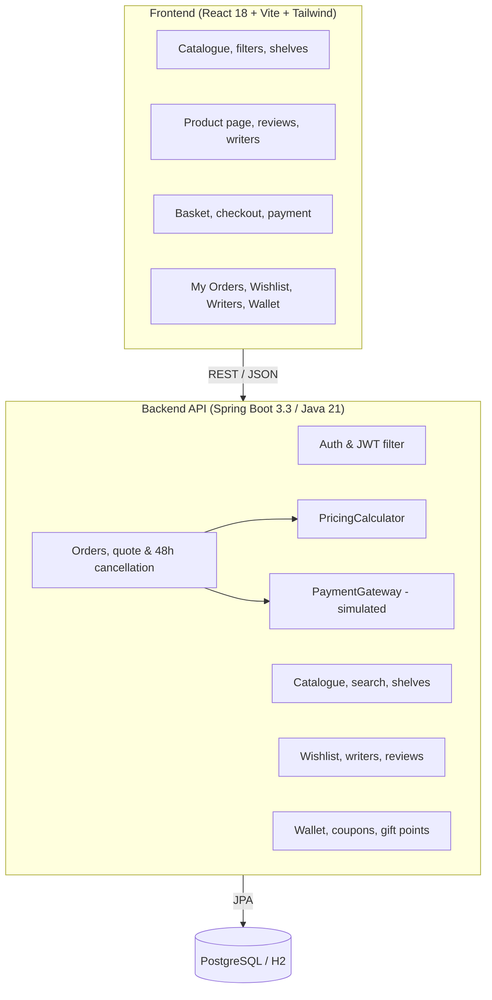

# Book Worm — E-Bookstore Platform (AI Specialist Cloud FullStack Capstone)

An online bookstore: browse by genre and brand, read about a book and its writer, fill a basket, pay with a card, UPI or wallet,
redeem gift points and coupons, and cancel any order within 48 hours. Built with agentic IDEs (IBM Bob for the first build, Claude Code for the slide 4 revision) for the
IBM AI Specialist capstone. Prices are in Indian rupees (₹).

---

## What is in it

- **Catalogue**: genre sidebar, search, language / format / price filters, sort, publisher filter, and Recommended / Bestsellers / New Launches shelves.
- **Product page**: delivery date, Add to Cart / Add to Wishlist, language, rating, copies sold, about the writer (with Follow), reviews, Related Reads.
- **My Orders, My Wishlist, My Writers, Policies** pages. On My Orders: **track** the parcel, **change** an order before it ships, and **return** delivered books.
- **Guest, member and administrator access.** Guests browse the public catalogue; signed-in members also see members-only categories; administrators get an **Admin** console
  (orders and shipping, returns, catalogue and stock, stores and policies). Sign-out revokes the token on the server.
- **Checkout**: address form, coupon, gift points, server-priced Grand Total, and Credit / Debit / UPI / Wallet payment (simulated gateway).
- **Rules**: 12% tax, free delivery from ₹499 (otherwise ₹29 local / ₹49 regional / ₹79 national by delivery zone), 1 gift point = ₹1,
  1 point earned per ₹100, 48-hour cancellation with refund, order changes before shipping, 7-day returns after delivery with refund on receipt.
- **Suggestions**: related reads, up-sell ("Consider this instead") and cross-sell ("Goes well with").
- **API**: contract-first [OpenAPI 3.0](docs/openapi.yaml) (72 operations) with Swagger UI at `/api/v1/swagger-ui.html`.
- **Stack**: Spring Boot 3.3 (Java 21), JWT, JPA, PostgreSQL or H2; React 18, Vite, Tailwind CSS.
- **Ops**: Dockerfiles, `docker-compose.yml`, OpenShift (ROKS / ROSA) manifests.

> Payments are simulated. No real money moves, and card numbers, expiry and CVV are never stored.

---

## Architecture



---

## Quick start (no database needed)

The default profile uses an in-memory **H2** database that is seeded on every start.

```powershell
# Terminal 1: API on http://localhost:8080/api/v1
cd backend
./mvnw spring-boot:run

# Terminal 2: UI on http://localhost:5173
cd frontend
npm install
npm run dev
```

Demo customer: **alex.dev@ibm.com / Password123!** (the sign-in dialog has a **Use demo account** button).
It starts with 250 gift points and ₹1,500 in the wallet, one order in its cancellation window and one delivered order you can return.

Demo administrator: **admin@bookworm.example / Password123!** (shows the **Admin** tab). **Both demo accounts and the demo signing key are public;
remove them before any real deployment.** On the `postgres` profile the app refuses to start unless `JWT_SECRET` is set to your own value
(`openssl rand -base64 64`).

Test cards: `4242 4242 4242 4242` succeeds, `4000 0000 0000 0002` is declined. Use any future expiry and any 3-digit CVV.
Coupons: `WELCOME10`, `BOOKS100`, `CLOUD20`.

## Run with PostgreSQL (Docker)

```powershell
docker compose up --build
```

- UI: http://localhost:3000
- API: http://localhost:8080/api/v1 · Swagger: http://localhost:8080/api/v1/swagger-ui.html

Credentials come from `POSTGRES_USER`, `POSTGRES_PASSWORD` and `JWT_SECRET` in your environment or a local `.env` file.
**Set `JWT_SECRET` yourself:** the default in `docker-compose.yml` is the public demo value, and the backend container will refuse to start with it. The PostgreSQL profile uses its own idempotent scripts in
`backend/src/main/resources/db/postgres/`. They are written to be safe to re-run (`IF NOT EXISTS`, `ON CONFLICT DO NOTHING`) and never drop tables.

> The PostgreSQL scripts and the compose / OpenShift files were checked for syntax and idempotency but have not been run
> against a live PostgreSQL server, Docker or a cluster from this repository. See the report for details.

## Prove it on PostgreSQL and OpenShift

```bash
deploy/verify-postgres.sh        # needs Docker: throwaway PostgreSQL 16, boots the app, replays the API, restarts, compares
oc login ...                     # a cluster, for example the free Red Hat Developer Sandbox
deploy/deploy-openshift.sh       # creates secrets, builds images in the cluster, applies the manifest, prints the evidence
```

The PostgreSQL scripts have been run on a real PostgreSQL 16.16 (details and the bugs that run found are in the report). The OpenShift manifest passes strict schema
validation but **has not been applied to a cluster**; `deploy/deploy-openshift.sh` is how to do that and capture the evidence.

## Tests

```powershell
cd backend
./mvnw test        # 79 tests, including full-stack API tests on the real schema and seed data
```

Import [`docs/bookstore-api-collection.json`](docs/bookstore-api-collection.json) into Postman or Insomnia for the 88 API requests.
Folders 8 to 13 carry test scripts, so they can be run as a contract check, for example with `newman run docs/bookstore-api-collection.json --folder "8. Roles, Entitlement and Logout"`
(run on a freshly started backend: the folders rely on the seeded data).

---

## Documentation

- [Submission report, security section & video script](SUBMISSION_REPORT.md)
- [OpenAPI 3.0 specification](docs/openapi.yaml)
- [Data model & business rules](docs/data-model.md)
- [Agentic IDE workflow journal](docs/agentic-ide-workflow.md)
- [Docker Compose](docker-compose.yml) · [OpenShift manifest](deploy/k8s/bookstore-roks-deployment.yaml)
