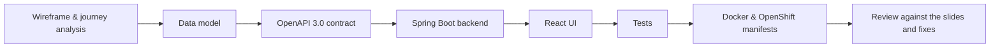

# AI Specialist Capstone — Cloud FullStack Bookstore Submission Report

**Author / Candidate**: Avi Chauhan
**Agentic IDE Employed**: IBM Bob for the original build (as recorded by the author). The slide 4 revision, its tests and these documents were done with Claude Code; see section 5a of the [workflow journal](docs/agentic-ide-workflow.md).
**Target Platform**: Spring Boot 3.3 (Java 21), React 18, PostgreSQL, deployable to Red Hat OpenShift (ROKS / ROSA)
**Date**: November 2026

---

## 1. Executive Summary

This submission implements the **AI Specialist — Cloud FullStack Capstone**: an online bookstore ("Book Worm") where a customer can log in, browse a catalogue by genre and brand, read about a book and its writer, fill a basket, redeem gift points and coupons, pay, and cancel within 48 hours.

What is delivered:

- Contract-first **OpenAPI 3.0** spec (59 paths, **72 operations** in 13 groups). It was checked against the running server: every served route is documented and none is documented but missing.
- **Spring Boot 3 / Java 21** backend with JWT security, role-based access, JPA, PostgreSQL support and an H2 profile for quick starts.
- **React 18 + Vite + Tailwind** frontend built to the wireframes on slides 5 to 10: dark theme, genre sidebar, five-control filter bar, Recommended / Bestsellers / New Launches shelves, product page with writer and reviews, checkout, payment and confirmation screens.
- Business rules: **48-hour cancellation**, **gift points**, **coupons**, **wallet**, **order-history recommendations** and **Buy It Again**.
- The back-office and after-sales requirements from the architecture slide (slide 4), added after the first review: **guest / member / administrator** access,
  **logout**, **stores and store policies**, **catalogue administration**, **shipments with zone-based delivery rates and tracking**, **order modification**,
  **returns with refunds**, and **up-sell / cross-sell** suggestions. See section 4.
- **79 automated backend tests**, a **88-request Postman collection** with assertions, and a scripted browser walk-through of the full customer and administrator journeys.
- Dockerfiles, `docker-compose.yml` and OpenShift manifests.

All prices are in **Indian rupees (₹)**, matching the wireframes.

---

## 2. Workflow



The prompts and outputs of the sessions are logged in [`docs/agentic-ide-workflow.md`](docs/agentic-ide-workflow.md). Section 4 of that journal lists the gaps found when the first build was compared with the wireframes, and how each was closed.

| Stage | Output |
|---|---|
| Requirements | [`docs/data-model.md`](docs/data-model.md), [`backend/src/main/resources/schema.sql`](backend/src/main/resources/schema.sql) |
| API contract | [`docs/openapi.yaml`](docs/openapi.yaml), Swagger UI at `/api/v1/swagger-ui.html` |
| Backend | [`backend/src/main/java/`](backend/src/main/java/) |
| Frontend | [`frontend/src/`](frontend/src/) |
| Tests | [`backend/src/test/java/`](backend/src/test/java/), [`docs/bookstore-api-collection.json`](docs/bookstore-api-collection.json) |
| Security | Section 5 of this report; [`SecurityIntegrationTest`](backend/src/test/java/com/ibm/capstone/bookstore/SecurityIntegrationTest.java) |
| Deployment | [`docker-compose.yml`](docker-compose.yml), [`deploy/k8s/`](deploy/k8s/bookstore-roks-deployment.yaml) |

---

## 3. The 12 customer journeys (slide 3)

| # | Journey step | Where it lives |
|---|---|---|
| 1 | Login page | `AuthModal.jsx`, `POST /auth/login`; sign-up and demo account |
| 2 | User authentication | JWT filter, `GET /auth/me` |
| 3 | Access catalogue for each category | `CatalogPage.jsx`, `GET /books`; genre sidebar |
| 4 | Order history with Buy It Again; recommendations | `OrdersPage.jsx`, `POST /orders/{id}/reorder`, "Recommended for You" shelf |
| 5 | Select the category of products | Genre sidebar, `GET /categories` |
| 6 | Browse the brands | Publisher filter, `GET /publishers` |
| 7 | Select the product, with tentative delivery date; related products | `BookDetailModal.jsx` ("Delivery by Sat, 7 Nov", "Related Reads") |
| 8 | Add the product(s) to basket | `CartDrawer.jsx`, `/cart` |
| 9 | Select the address for delivery | `CheckoutModal.jsx` + `AddressForm.jsx`, `/users/addresses` |
| 10 | Initiate payment with the right option; redeem gift points | `PaymentPanel.jsx` (Credit / Debit / UPI / Wallet), points slider |
| 11 | Payment confirmation | `OrderConfirmationModal.jsx` |
| 12 | Confirmation on purchase; cancel within 48 hrs | Confirmation modal, `POST /orders/{id}/cancel`, `OrdersPage.jsx` |

Wireframe extras also built: **My Wishlist**, **My Writers** (follow a writer, see their books), **About the writer**, **Reviews**, **coupon box**, **Tax and Delivery lines** in the Grand Total.

---

## 3a. Requirements from the architecture slide (slide 4)

The first submission built the customer journeys on slides 3 and 5 to 10 but did not read the diagram on slide 4 closely. Its notes list further
requirements, which this revision adds. Each one is covered by a test.

| Slide 4 requirement | What was built |
|---|---|
| Guest / registered users | Guests browse the public catalogue, writers, coupons, policies and delivery quotes. Members also see members-only categories, the basket and orders. A members-only book returns **404** to a guest, so its existence is not revealed. |
| Login & logout | `POST /auth/logout` revokes the token on the server (it is rejected afterwards, not just forgotten by the browser). |
| Role & entitlement | `ROLE_ADMIN` guards everything under `/admin`. A signed-in customer gets **403**; a guest gets **401**. |
| Create stores, catalogs, store policies | Administrator API and screen: stores, policies (cancellation, returns, shipping, privacy, payment), categories (public or members-only), books and stock. ISBNs and category names are unique and category counts stay correct. |
| Modify order | `PATCH /orders/{id}`: change the address or take books off before the parcel ships. Removed books are refunded exactly. |
| Return order, return shipment, refund processing | A delivered order can be returned inside the store's return window (7 days by default). The customer gets a return number and a collection tracking number. **Nothing is refunded or restocked until the store records that the parcel arrived**, and a return cannot be refunded twice. |
| Shipping rate calculation, approximate delivery time | Three zones (local, regional, national) from the delivery address, each with its own charge, carrier and transit time. Free delivery from Rs 499 applies in every zone. The quote the customer sees is the amount charged. |
| Shipment | One shipment per order with carrier, tracking number and a status timeline the customer can open. |
| Up-sell & cross-sell | "Consider this instead" (higher-rated, same category, at most 40% dearer) and "Goes well with" (bought together by other customers, then top-rated from other categories). Both are on the book page; cross-sell is also in the basket. |

**Refund maths.** Cancelling, changing and returning all use one class (`RefundCalculator`). A refund is the books' price, minus their share of the coupon,
plus their share of the tax, plus delivery only when nothing is left. Gift points come back in proportion. The final refund on an order settles whatever is left,
so across any sequence of partial refunds the total refunded equals the total paid, to the rupee. A unit test checks this directly.

---

## 4. Business rules

All maths lives in one class (`PricingCalculator`) used by the basket, the quote endpoint and order placement, so the amount shown is the amount charged.

| Rule | Behaviour |
|---|---|
| Tax | 12% of the subtotal after any coupon |
| Delivery | Free from ₹499, otherwise ₹49 |
| Coupons | `WELCOME10` (10%, up to ₹300), `BOOKS100` (₹100 off above ₹999), `CLOUD20` (20% above ₹1,500, up to ₹500) |
| Gift points | Redeem 1 point = ₹1 off; earn 1 point per ₹100 paid |
| Delivery by zone | Local Rs 29, regional Rs 49, national Rs 79; free from Rs 499 in every zone (rates are in `application.yml`) |
| 48-hour cancel | Restores stock, returns redeemed points, revokes earned points (ledger entry), refunds wallet money. Refunds only what is still outstanding after any earlier partial refund |
| Order changes | Until the parcel ships and within 24 hours: new address (not a farther zone) or take books off (refunded). The last book cannot be removed; cancel instead |
| Returns | Delivered orders only, inside the return window; refund on receipt of the parcel, never on request |
| Payment | Validated **before** anything changes, so a declined payment leaves stock, points and basket untouched |

### Payments are simulated
There is no real payment processor. A `PaymentGateway` class validates the instrument as a real gateway front end would (Luhn check, future expiry, CVV, UPI ID format, wallet balance) and returns a reference. **Card numbers, expiry and CVV are never stored**; only the last four digits are kept. Test card `4242 4242 4242 4242` succeeds and `4000 0000 0000 0002` is declined.

---

## 5. Testing — what was run and what was not

| Check | Result |
|---|---|
| Backend: `./mvnw test` | **79 tests pass**: 4 book, 14 API integration, 14 lifecycle integration (slide 4), 7 security, 6 secret guard, 5 login limiter, 12 order, 7 payment, 6 pricing/coupon, 4 refund maths |
| API integration | Boots the whole app on H2 with the real `schema.sql` and `data.sql` and drives it over HTTP: filters, shelves, auth, wishlist, writers, reviews, coupons, quote, address validation, declined card, checkout, cancel, wallet |
| Postman collection | **88 requests in 14 folders.** The 49 new requests (folders 8 to 13) carry test scripts and were replayed with Newman against a freshly seeded server: all 65 assertions pass. The original 36 requests still work |
| OpenAPI | Parses; every `$ref` resolves; operation ids are unique; **72 operations documented and 72 served**, none missing either way; every `/admin` operation is secured and documents a 403; public and secured status matches what the live server does for guests |
| Frontend build | `npm run build` succeeds |
| Browser walk-through (slide 4) | A scripted Chromium session passed 15 of 15 steps on fresh data, with no console errors: guest vs member catalogue, policies page and rate checker, up-sell and cross-sell, tracking, a return request, sign-out, administrator login, receiving a return, marking an order shipped, creating a members-only category, and the phone navigation. Driving the real screens found two bugs the API tests could not: after signing in, the catalogue did not reload so a member still saw the guest list, and the admin forms ran off the edge of a 375px phone. Both are fixed |
| Browser walk-through (original) | A scripted Chrome session passed 17 of 17 steps: landing, filters, sign-in, product page, review, wishlist, writers, basket, checkout validation, bad and good coupon, declined card, successful order, cancel, wallet top-up, phone layout. It also caught and led to fixes for a cramped phone navigation bar, stacking notifications and broken cover titles |

### Run on a real PostgreSQL (the first review's gap)

The first review said the PostgreSQL scripts had not been validated on a live database. They have now been run on **PostgreSQL 16.16**
(a native Windows build of the real server, started on its own port; Docker was not available on the machine). That is genuine PostgreSQL
with its own SQL dialect and stricter typing, but it is **not** the Red Hat container image the OpenShift manifest uses, and it was not run through Docker.
The whole sequence is scripted in [`deploy/verify-postgres.sh`](deploy/verify-postgres.sh) so it can be repeated on a machine with Docker.

| Check | Result on PostgreSQL 16.16 |
|---|---|
| Fresh database, `postgres` profile | The schema script created **22 tables**, the seed script loaded the data (3 users, 17 books, 6 categories, 1 store with policies, 2 orders), and Hibernate's `ddl-auto: validate` accepted all entities against the tables |
| Data really is in the database | Row counts read straight from PostgreSQL over JDBC (slide 12, step 8: "check data is saved in the database") |
| API replayed | The 49 new Postman requests (65 assertions) pass: roles, logout, stores, catalogue administration, shipments, returns with refunds, up-sell and cross-sell. This includes a `GROUP BY ... ORDER BY COUNT` query that H2 is lenient about |
| Restart changes nothing | After a return was refunded and a store created, the app was restarted: identical row counts, the refund and the restock intact, nothing duplicated |
| IDs cannot collide | With a row at id 500, the next id after restart was 501, not a fall-back to 100 |
| Upgrade in place | A database built from the **previous release's** scripts (16 tables, a customer order inside) was upgraded by starting the new version: 22 tables, new columns added with defaults, the old order kept |

**Bugs only the real PostgreSQL run found** (none appeared on H2):
1. **Fresh database failed to start** with `Schema-validation: missing table [addresses]`. The default profile defers the SQL scripts until after Hibernate (right for H2, where Hibernate creates the tables), and the `postgres` profile inherited that, so Hibernate validated tables the scripts had not created yet. This would have broken `docker compose up` and the OpenShift deploy on first start. Fixed in `application-postgres.yml`.
2. **Modifying an order from before delivery zones existed returned a 500** (a null zone was compared). It only exists in an upgraded database, never in a fresh H2. Fixed, with tests that fail without the fix.
3. **A signing secret generated with the recommended command was rejected on Windows.** `openssl` there ends lines with CRLF, and the stray carriage return failed the guard's strict base64 check. The scripts now strip it, and the guard ignores surrounding whitespace.
4. **Two defects in the verification script itself**, found by running it: it trusted any healthy answer on its port (so a leftover application could make a run "pass" against the wrong database), and its restart step stopped the Maven wrapper but not the Java process, so the "restart" did nothing. Both fixed; the script now refuses to start if the port is taken and waits for the port to free.

### OpenShift manifest: checked, not applied

- The manifest has 12 resources. **11 pass strict schema validation** (`kubeconform`, Kubernetes 1.30); the OpenShift `Route` is not in that schema, so it was skipped by the validator and checked by hand.
- A review found and fixed gaps a schema cannot see: the Secret was in the file with placeholder values (it is now created by the deploy script from real random values, and the pods fail loudly without it); no container had a security context (all now drop every capability, forbid privilege escalation, require non-root and use the runtime seccomp profile); nothing restricted network traffic (four NetworkPolicies now allow only router to frontend to backend to database, and the labels, ports and Service selectors were cross-checked); the backend had no startup probe and a 90-second guess for a slow first start; and the two images this project builds were tagged `:latest`.
- The Red Hat PostgreSQL image keeps its floating `:latest` tag: a pinned tag could not be verified from this machine (the registry needs a login), and a wrong one would stop the database from starting.
- [`deploy/deploy-openshift.sh`](deploy/deploy-openshift.sh) creates the secrets, builds the images in the cluster, applies the manifest and then **prints the evidence**: pods, route, health, a real sign-in through the public URL, row counts out of the database pod, and a network-policy probe. The probe reports `BLOCKED`, `REACHABLE` or `INCONCLUSIVE` and only counts a real connection timeout as the policy working; its classification was tested locally against open, closed, unresolvable and non-routable targets.
- **It has not been applied to a cluster.** No cluster was available. This remains the one open item from the first review. Running `deploy/deploy-openshift.sh` on the free Red Hat Developer Sandbox produces the evidence.

### Still not verified

- **A live OpenShift or Kubernetes cluster**, as above. That includes the `Route`, image builds in the cluster, the NetworkPolicies being enforced, and the application running as OpenShift's arbitrary non-root user.
- **The container images.** Neither Dockerfile has been built or run here.
- The automated test generator named on slide 11 (ICA Agent) was **not** used. The tests in this repository were written directly. If you used the ICA Agent, add that to the journal; otherwise say so honestly in the video.

---

## 5. Security

What is protected, how, and how it was checked. The **limits** are listed as plainly as the controls, because a review is more useful that way.

### Controls

| Area | Control | Checked by |
|---|---|---|
| Authentication | Passwords are hashed with **BCrypt**. Sign-in returns a signed **JWT** (HS512, 24 hours, with a unique id). | Integration tests |
| Forged tokens | A changed signature, a payload swapped to the administrator with the old signature, a stripped signature, the classic `alg=none` forgery and a non-token are all refused (401) on a member route **and** an admin route. | `SecurityIntegrationTest`. The test was made to fail by deliberately removing signature checking, to confirm it can catch a real bypass |
| Authorization | URL rules and `@PreAuthorize` both require `ROLE_ADMIN` for `/admin`. A customer gets a clear 403 (an explicit handler writes it; without it the container turned it into a misleading 401). Members-only books are filtered in every query path, not only the list. | `LifecycleApiIntegrationTest`, `SecurityIntegrationTest` |
| Logout | The token's id is stored until it would have expired; the filter refuses it. Logging out twice is harmless. | `LifecycleApiIntegrationTest` |
| Password guessing | Five wrong passwords for one email in five minutes pause sign-in for that email (429), without locking other accounts. Memory is bounded: each email keeps at most five timestamps, expired entries are swept, and at most 10,000 emails are tracked (oldest evicted first). | `LifecycleApiIntegrationTest`, `LoginAttemptLimiterTest` (with a movable clock; removing the cap or the expiry makes it fail) |
| Weak signing secret | On the `postgres` (production-like) profile the app **refuses to start** if `JWT_SECRET` is the demo value published in the repository, is not base64, is under 32 bytes, or looks guessable (a short pattern repeated, very few different characters, or a long run of one character, such as `ChangeMe...` or a real key padded with zeros). Surrounding whitespace from a pasted secret is ignored. | `JwtSecretGuardTest` reads the real files, and checks that 2,000 random secrets are never refused; each rule was shown to fail its test when removed; confirmed by booting the app both ways |
| Injection | JPA with bound parameters and criteria queries; search and sort values are data. An injected `' OR 1=1--` matches nothing and a `DROP TABLE` in a sort value does nothing. | `SecurityIntegrationTest` |
| Response headers | `X-Content-Type-Options: nosniff`, framing denied (same-origin only while the H2 console is enabled), `Referrer-Policy: no-referrer`, and `Content-Security-Policy: default-src 'none'` on API responses (not on Swagger UI, which needs its own scripts). | `SecurityIntegrationTest` |
| Operational endpoints | `/actuator/health` is public for platform probes; every other actuator path is administrator-only. The H2 console only exists while its dev setting is on (the `postgres` profile turns it off). | `SecurityIntegrationTest` |
| Error handling | Errors return a short message, never a stack trace or class name. A 401 reports the path that was requested. | `SecurityIntegrationTest` (it fails if the fix is removed) |
| Payment data | Card number, expiry and CVV are validated and discarded. Only the last four digits and a gateway reference are stored. Nothing sensitive is logged. | Code review, `PaymentGatewayTest` |
| Money integrity | Totals come from the server only. Payment is validated **before** stock, points or wallet change. Refunds cannot exceed what was paid. | `OrderServiceTest`, `RefundCalculatorTest` |
| Input validation | Every request body is validated (lengths, ranges, required fields, allowed values). | Integration tests |
| Containers and secrets | The backend runs as a non-root user and the frontend uses the unprivileged nginx image. No `.env` or key is tracked in git; the OpenShift manifest ships `CHANGE_ME` placeholders that must be replaced. | Review of the Dockerfiles, manifest and `git ls-files` |

### Known limits (not hidden)

- **The demo accounts and the demo JWT secret are public.** The `H2` quick-start profile is allowed to use them so it runs with no setup; the `postgres` profile refuses the secret, but the demo user and the demo administrator (`admin@bookworm.example`) are in the seed data. **Remove them before any real deployment.**
- **CSRF protection is switched off.** That is the usual choice for an API that authenticates with a bearer token in a header and keeps no cookies, but it should be revisited if cookies are ever introduced.
- **The token is kept in the browser's `localStorage`**, so a script injected into the page could read it. The frontend uses no `dangerouslySetInnerHTML`, `innerHTML` or `eval`, and the API sets a strict CSP, which lowers the risk; an httpOnly cookie would remove it.
- **The login rate limiter is in memory**, so it is per instance and resets on restart. That is right for the single-replica deployment here; several replicas would need a shared store.
- **Tokens cannot be revoked per user**, only per token: changing a password does not sign out other sessions.
- **There is no rate limit outside sign-in**, no account lockout notification, and no multi-factor authentication.
- **TLS is not terminated by the application.** On OpenShift the Route does it (edge termination, HTTP redirected); the local Docker setup is plain HTTP.
- **No dependency or image vulnerability scan was run** here.
- **The Red Hat database image is not pinned to an exact version** (see above).
- **Payments are simulated.** No real processor is involved, so none of the controls above has been exercised against one.

---

## 6. Running it

**Quick start (H2, no database needed)**

```powershell
cd backend
./mvnw spring-boot:run          # API on http://localhost:8080/api/v1  (Swagger: /swagger-ui.html)
```
```powershell
cd frontend
npm install
npm run dev                     # http://localhost:5173
```

Demo account: `alex.dev@ibm.com` / `Password123!` (the **Use demo account** button fills it in). It starts with 250 gift points and ₹1,500 in the wallet.

**Prove it on PostgreSQL** (needs Docker): `deploy/verify-postgres.sh` starts a throwaway PostgreSQL 16, boots the backend on it, replays the API collection, restarts the backend and checks nothing changed.

**Deploy to OpenShift** (needs `oc` and a cluster, for example the free Red Hat Developer Sandbox): `oc login ...` then `deploy/deploy-openshift.sh` (pass your sandbox namespace as the first argument). It prints the evidence at the end.

**PostgreSQL via Docker**

```powershell
docker compose up --build       # UI http://localhost:3000, API http://localhost:8080/api/v1
```
Database credentials come from `POSTGRES_USER`, `POSTGRES_PASSWORD` and `JWT_SECRET` (a local `.env` file or the environment). The defaults in the compose file are for a local demo only.

**Tests**

```powershell
cd backend
./mvnw test                     # 79 tests
```

---

## 7. Video walkthrough script (about 6 minutes)

Slide 11 asks for a recorded video that describes the steps. Before recording, start the stack and open the app. The demo customer is `alex.dev@ibm.com` / `Password123!` and the demo administrator is `admin@bookworm.example` / `Password123!`.

**[0:00 – 0:45] Introduction and workflow.** Show the repo tree, then `docs/agentic-ide-workflow.md`. Explain how you used IBM Bob: wireframes to data model, OpenAPI contract, backend, UI, tests. Mention the review against the slides (journal section 4).

**[0:45 – 1:45] Home, login, catalogue, genre, brand (journeys 1 to 6).** Show the landing page and the three shelves. Click **Sign in**, then **Use demo account**. Search "OpenShift", then clear it. Click genres in the left rail. Use the **Format** and **Price range** filters and the **Publisher** buttons. Point out **Recommended for You**.

**[1:45 – 2:30] Product page, delivery date, related reads, basket (journeys 7 and 8).** Open a book. Show the delivery date, **About the writer** (try Follow), **Reviews**, and **Related Reads**. Click **Add to Cart**, open the basket, change a quantity and note the free-delivery message.

**[2:30 – 3:30] Address, payment, gift points, confirmation (journeys 9 to 11).** Click **Checkout**. Show the address cards and **Add new address**. Apply coupon `WELCOME10`, drag the **Gift points** slider and watch **Total Amount** change. Open the payment tabs. Try card `4000 0000 0000 0002` to show a decline, then `4242 4242 4242 4242` with any future date. Show the confirmation: books, payment reference, points earned.

**[3:30 – 4:15] Orders, 48-hour cancel, Buy It Again (journey 12).** Open **My Orders**. Show "hours left to cancel for free", cancel the order and show the points and stock restored (top-right points). Click **Buy it again**.

**[4:15 – 5:00] After-sales and administration (slide 4).** On **My Orders** show **Track** (carrier, tracking number, timeline) and **Return books** on the delivered order. Sign out, sign in as the administrator, open **Admin**, go to **Returns** and press *Received: restock and refund*; point out that the refund and the stock change only now. Show **Orders & shipping** (mark shipped), and create a members-only category to show a guest cannot see it.

**[5:00 – 5:45] API, tests, security and deployment.** Open Swagger UI and run one call. Show `docs/openapi.yaml` (72 operations), run `./mvnw test` (79 tests), then show the security section of this report, `docker-compose.yml`, the Dockerfiles, `deploy/k8s/bookstore-roks-deployment.yaml` and the GitHub pull request. If you used the ICA Agent for any tests, say so here; if not, say the tests were written directly.
