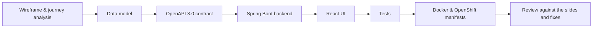

# AI Specialist Capstone — Cloud FullStack Bookstore Submission Report

**Author / Candidate**: Avi Chauhan
**Agentic IDE Employed**: IBM Bob
**Target Platform**: Spring Boot 3.3 (Java 21), React 18, PostgreSQL, deployable to Red Hat OpenShift (ROKS / ROSA)
**Date**: November 2026

---

## 1. Executive Summary

This submission implements the **AI Specialist — Cloud FullStack Capstone**: an online bookstore ("Book Worm") where a customer can log in, browse a catalogue by genre and brand, read about a book and its writer, fill a basket, redeem gift points and coupons, pay, and cancel within 48 hours.

What is delivered:

- Contract-first **OpenAPI 3.0** spec (30 paths, 37 operations) that matches the code route for route.
- **Spring Boot 3 / Java 21** backend with JWT security, JPA, PostgreSQL support and an H2 profile for quick starts.
- **React 18 + Vite + Tailwind** frontend built to the wireframes on slides 5 to 10: dark theme, genre sidebar, five-control filter bar, Recommended / Bestsellers / New Launches shelves, product page with writer and reviews, checkout, payment and confirmation screens.
- Business rules: **48-hour cancellation**, **gift points**, **coupons**, **wallet**, **order-history recommendations** and **Buy It Again**.
- **40 automated tests** plus a scripted browser walk-through of the full customer journey.
- Dockerfiles, `docker-compose.yml` and OpenShift manifests.

All prices are in **Indian rupees (₹)**, matching the wireframes.

---

## 2. Workflow



The prompts and outputs of the IBM Bob sessions are logged in [`docs/agentic-ide-workflow.md`](docs/agentic-ide-workflow.md). Section 4 of that journal lists the gaps found when the first build was compared with the wireframes, and how each was closed.

| Stage | Output |
|---|---|
| Requirements | [`docs/data-model.md`](docs/data-model.md), [`backend/src/main/resources/schema.sql`](backend/src/main/resources/schema.sql) |
| API contract | [`docs/openapi.yaml`](docs/openapi.yaml), Swagger UI at `/api/v1/swagger-ui.html` |
| Backend | [`backend/src/main/java/`](backend/src/main/java/) |
| Frontend | [`frontend/src/`](frontend/src/) |
| Tests | [`backend/src/test/java/`](backend/src/test/java/), [`docs/bookstore-api-collection.json`](docs/bookstore-api-collection.json) |
| Deployment | [`docker-compose.yml`](docker-compose.yml), [`deploy/k8s/`](deploy/k8s/bookstore-roks-deployment.yaml) |

---

## 3. The 12 customer journeys (slide 3)

| # | Journey step | Where it lives |
|---|---|---|
| 1 | Login page | `AuthModal.jsx`, `POST /auth/login`; sign-up and demo account |
| 2 | User authentication | JWT filter, `GET /auth/me` |
| 3 | Access catalogue for each category | `CatalogPage.jsx`, `GET /books`; genre sidebar |
| 4 | Order history with Buy It Again; recommendations | `OrdersPage.jsx`, `POST /orders/{id}/reorder`, "Recommended for You" shelf |
| 5 | Select the category of products | Genre sidebar, `GET /categories` |
| 6 | Browse the brands | Publisher filter, `GET /publishers` |
| 7 | Select the product, with tentative delivery date; related products | `BookDetailModal.jsx` ("Delivery by Sat, 7 Nov", "Related Reads") |
| 8 | Add the product(s) to basket | `CartDrawer.jsx`, `/cart` |
| 9 | Select the address for delivery | `CheckoutModal.jsx` + `AddressForm.jsx`, `/users/addresses` |
| 10 | Initiate payment with the right option; redeem gift points | `PaymentPanel.jsx` (Credit / Debit / UPI / Wallet), points slider |
| 11 | Payment confirmation | `OrderConfirmationModal.jsx` |
| 12 | Confirmation on purchase; cancel within 48 hrs | Confirmation modal, `POST /orders/{id}/cancel`, `OrdersPage.jsx` |

Wireframe extras also built: **My Wishlist**, **My Writers** (follow a writer, see their books), **About the writer**, **Reviews**, **coupon box**, **Tax and Delivery lines** in the Grand Total.

---

## 4. Business rules

All maths lives in one class (`PricingCalculator`) used by the basket, the quote endpoint and order placement, so the amount shown is the amount charged.

| Rule | Behaviour |
|---|---|
| Tax | 12% of the subtotal after any coupon |
| Delivery | Free from ₹499, otherwise ₹49 |
| Coupons | `WELCOME10` (10%, up to ₹300), `BOOKS100` (₹100 off above ₹999), `CLOUD20` (20% above ₹1,500, up to ₹500) |
| Gift points | Redeem 1 point = ₹1 off; earn 1 point per ₹100 paid |
| 48-hour cancel | Restores stock, returns redeemed points, revokes earned points (ledger entry), refunds wallet money |
| Payment | Validated **before** anything changes, so a declined payment leaves stock, points and basket untouched |

### Payments are simulated
There is no real payment processor. A `PaymentGateway` class validates the instrument as a real gateway front end would (Luhn check, future expiry, CVV, UPI ID format, wallet balance) and returns a reference. **Card numbers, expiry and CVV are never stored**; only the last four digits are kept. Test card `4242 4242 4242 4242` succeeds and `4000 0000 0000 0002` is declined.

---

## 5. Testing — what was run and what was not

| Check | Result |
|---|---|
| Backend: `./mvnw test` | **40 tests pass** (4 book, 13 API integration, 10 order, 7 payment, 6 pricing/coupon) |
| API integration | Boots the whole app on H2 with the real `schema.sql` and `data.sql` and drives it over HTTP: filters, shelves, auth, wishlist, writers, reviews, coupons, quote, address validation, declined card, checkout, cancel, wallet |
| Postman collection | All 36 requests replayed against a freshly seeded server and returned the documented status |
| OpenAPI | Parses; every `$ref` resolves; every route the controllers serve is documented, none documented that is not served |
| Frontend build | `npm run build` succeeds |
| Browser walk-through | A scripted Chrome session passed 17 of 17 steps: landing, filters, sign-in, product page, review, wishlist, writers, basket, checkout validation, bad and good coupon, declined card, successful order, cancel, wallet top-up, phone layout. It also caught and led to fixes for a cramped phone navigation bar, stacking notifications and broken cover titles |

**Not verified here — please read:**

- **PostgreSQL and Docker were not run.** This machine has no Docker and no Postgres server. The PostgreSQL scripts (`backend/src/main/resources/db/postgres/`) were generated from the H2 ones and executed twice on H2 in PostgreSQL mode to prove they are idempotent, but real PostgreSQL has not accepted them yet. The default profile is **H2 in memory**; PostgreSQL is selected with `SPRING_PROFILES_ACTIVE=postgres` (this is what `docker-compose.yml` does). Run `docker compose up --build` once on a machine with Docker before recording the video.
- **The OpenShift manifest was parsed but not applied** to a cluster.
- The automated test generator named on slide 11 (ICA Agent) was **not** used. The tests in this repository were written directly. If you used the ICA Agent, add that to the journal; otherwise say so honestly in the video.

---

## 6. Running it

**Quick start (H2, no database needed)**

```powershell
cd backend
./mvnw spring-boot:run          # API on http://localhost:8080/api/v1  (Swagger: /swagger-ui.html)
```
```powershell
cd frontend
npm install
npm run dev                     # http://localhost:5173
```

Demo account: `alex.dev@ibm.com` / `Password123!` (the **Use demo account** button fills it in). It starts with 250 gift points and ₹1,500 in the wallet.

**PostgreSQL via Docker**

```powershell
docker compose up --build       # UI http://localhost:3000, API http://localhost:8080/api/v1
```
Database credentials come from `POSTGRES_USER`, `POSTGRES_PASSWORD` and `JWT_SECRET` (a local `.env` file or the environment). The defaults in the compose file are for a local demo only.

**Tests**

```powershell
cd backend
./mvnw test
```

---

## 7. Video walkthrough script (about 5 minutes)

Slide 11 asks for a recorded video that describes the steps. Before recording, start the stack and open the app. The demo account is `alex.dev@ibm.com` / `Password123!`.

**[0:00 – 0:45] Introduction and workflow.** Show the repo tree, then `docs/agentic-ide-workflow.md`. Explain how you used IBM Bob: wireframes to data model, OpenAPI contract, backend, UI, tests. Mention the review against the slides (journal section 4).

**[0:45 – 1:45] Home, login, catalogue, genre, brand (journeys 1 to 6).** Show the landing page and the three shelves. Click **Sign in**, then **Use demo account**. Search "OpenShift", then clear it. Click genres in the left rail. Use the **Format** and **Price range** filters and the **Publisher** buttons. Point out **Recommended for You**.

**[1:45 – 2:30] Product page, delivery date, related reads, basket (journeys 7 and 8).** Open a book. Show the delivery date, **About the writer** (try Follow), **Reviews**, and **Related Reads**. Click **Add to Cart**, open the basket, change a quantity and note the free-delivery message.

**[2:30 – 3:30] Address, payment, gift points, confirmation (journeys 9 to 11).** Click **Checkout**. Show the address cards and **Add new address**. Apply coupon `WELCOME10`, drag the **Gift points** slider and watch **Total Amount** change. Open the payment tabs. Try card `4000 0000 0000 0002` to show a decline, then `4242 4242 4242 4242` with any future date. Show the confirmation: books, payment reference, points earned.

**[3:30 – 4:15] Orders, 48-hour cancel, Buy It Again (journey 12).** Open **My Orders**. Show "hours left to cancel for free", cancel the order and show the points and stock restored (top-right points). Click **Buy it again**.

**[4:15 – 5:00] API, tests and deployment.** Open Swagger UI and run one call. Show `docs/openapi.yaml`, run `./mvnw test` (40 tests), then show `docker-compose.yml`, the Dockerfiles, `deploy/k8s/bookstore-roks-deployment.yaml` and the GitHub pull request.
