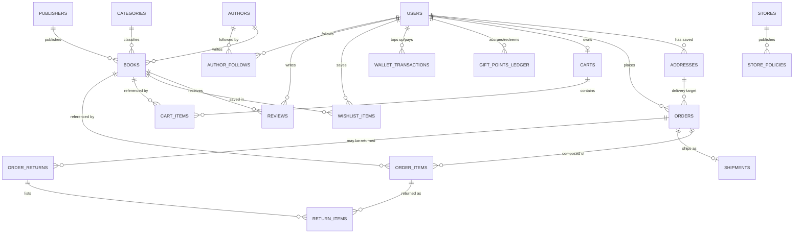

# E-Bookstore Platform — Data Model & Domain Architecture

This document describes the schema as implemented in `backend/src/main/resources/schema.sql` (H2, used for local
development and tests) and `backend/src/main/resources/db/postgres/schema.sql` (PostgreSQL, idempotent). The two files are
kept in step by hand and were compared table by table and column by column when this document was last updated: both define
22 tables with identical columns. The PostgreSQL file also carries `ALTER TABLE ... ADD COLUMN IF NOT EXISTS` lines so a database
created by an older version upgrades in place. All money is in Indian rupees (INR).

## 1. Domain Entities & ER Schema

`coupons` is a standalone lookup table; an order stores the code and the discount it received.
`revoked_tokens` is also standalone: it holds the ids of signed-out login tokens until they would have expired anyway.

---

## 2. Relational Schema Specification

### `users`
| Column | Type | Notes |
|---|---|---|
| `id` | `BIGINT` identity | Primary key |
| `email` | `VARCHAR(255)` | Unique, login credential |
| `password_hash` | `VARCHAR(255)` | BCrypt |
| `full_name`, `phone_number` | `VARCHAR` | Phone is optional |
| `gift_points_balance` | `INT` | New accounts start with 150 points |
| `wallet_balance` | `DECIMAL(10,2)` | Stored-value wallet, default 0 |
| `role` | `VARCHAR(50)` | `ROLE_CUSTOMER` (default) or `ROLE_ADMIN`. Decides what the API lets the caller do |
| `created_at` | `TIMESTAMP` | |

### `addresses`
`id`, `user_id` (FK, cascade delete), `recipient_name`, `email`, `phone_number`, `street_address`,
`address_line2` (optional), `city`, `state`, `postal_code` (PIN code), `country`, `is_default`.
These are the fields in the checkout wireframe (name, email, phone, address, address line 2, city, PIN, state, country).

### `categories`, `publishers`
- `categories`: `id`, `name` (unique), `slug` (unique), `description`, `book_count` (kept equal to the real number of books),
  `visibility` (`PUBLIC` or `MEMBERS`). Books in a `MEMBERS` category are invisible to guests everywhere: search, shelves,
  related and recommended lists, writer pages, and a direct request for one returns 404.
- `publishers` (brands): `id`, `name` (unique), `code` (unique), `website`.

### `authors` (writers)
`id`, `name` (unique), `bio`, `photo_url` (optional; the UI draws an initials avatar when it is empty).

### `books`
| Column | Type | Notes |
|---|---|---|
| `id` | `BIGINT` identity | Primary key |
| `title`, `author` | `VARCHAR(255)` | `author` is display text and may list co-authors |
| `author_id` | FK -> `authors` | Primary writer profile |
| `isbn` | `VARCHAR(20)` | Unique |
| `category_id`, `publisher_id` | FK | Genre and brand |
| `price`, `original_price` | `DECIMAL(10,2)` | Sale price and list price, in INR |
| `stock_quantity` | `INT` | Inventory |
| `rating`, `review_count` | `DECIMAL(3,2)`, `INT` | Running average, updated when a review is posted |
| `cover_image_url` | `VARCHAR(500)` | Optional; the UI draws a typographic cover when empty |
| `description` | `TEXT` | Synopsis |
| `published_year`, `launch_date` | `INT`, `DATE` | `launch_date` drives the "New Launches" shelf |
| `page_count` | `INT` | |
| `book_language`, `book_format` | `VARCHAR` | Catalog filters (for example English, Paperback/Hardcover/eBook) |
| `copies_sold` | `INT` | Drives the "Bestsellers" shelf; incremented on purchase, decremented on cancellation |
| `tentative_delivery_days` | `INT` | Used to compute the delivery date shown on cards |
| `is_featured` | `BOOLEAN` | Default sort priority |

### `reviews`
`id`, `book_id`, `user_id`, `rating` (1 to 5), `comment_text` (max 300 stored, 100 allowed by the API),
`created_at`. Unique on (`book_id`, `user_id`): one review per customer per book.

### `wishlist_items`, `author_follows`
Join tables with `user_id` and `book_id` / `author_id`, `created_at`, and a unique constraint so that adding twice is a no-op.
They back **My Wishlist** and **My Writers**.

### `coupons`
`code` (unique), `description`, `discount_type` (`PERCENT` or `FLAT`), `discount_value`, `min_order_amount`,
`max_discount` (optional cap), `active`, `expires_at` (optional).

### `carts` & `cart_items`
- `carts`: `id`, `user_id` (unique), `created_at`, `updated_at`.
- `cart_items`: `id`, `cart_id`, `book_id`, `quantity`, `unit_price`, `created_at`.

### `orders` & `order_items`
- `orders`:
  - `id`, `order_number` (`BK-YYYYMMDD-NNNNNN`), `user_id`, `address_id`
  - `order_status` (`CONFIRMED`, `PROCESSING`, `SHIPPED`, `DELIVERED`, `CANCELLED`, `RETURNED`)
  - `payment_status` (`PAID`, `PARTIALLY_REFUNDED`, `REFUNDED`, `FAILED`)
  - `subtotal`, `tax`, `shipping_fee`, `total_amount` (the amount actually paid, after coupon and points)
  - `coupon_code`, `coupon_discount`
  - `points_redeemed`, `points_discount`, `points_earned`
  - `wallet_amount_used`
  - `payment_method` (`CREDIT_CARD`, `DEBIT_CARD`, `UPI`, `WALLET`), `card_last4`, `payment_reference`
  - `shipping_zone` (`LOCAL`, `REGIONAL`, `NATIONAL`)
  - `estimated_delivery_date`, `created_at`, `cancelled_at`, `cancel_reason`, `modified_at`
  - `refunded_amount` (cash refunded so far), `points_refunded`, `points_revoked` (so a later refund never pays the same thing twice)
- `order_items`: `id`, `order_id`, `book_id`, `book_title`, `book_author`, `cover_image_url`, `quantity`, `unit_price`, `total_price`,
  `refunded_quantity` (units removed by an order change or returned; the units still on the order are `quantity - refunded_quantity`)
  (title and author are copied so history stays correct if the catalog changes).

Card numbers, expiry dates and CVVs are **never stored**. Only the last four digits and a gateway reference are kept.

### `stores` & `store_policies`
- `stores`: `id`, `name` (unique), `tagline`, `currency`, `return_window_days` (how long after delivery books can come back), `active`, `created_at`.
- `store_policies`: `id`, `store_id` (FK, cascade delete), `policy_type` (`CANCELLATION`, `RETURN`, `SHIPPING`, `PRIVACY`, `PAYMENT`, `OTHER`),
  `title`, `body`, `created_at`. Anyone can read the policies of an open store; only administrators change them.

### `shipments`
One row per order (`order_id` unique): `carrier`, `tracking_number`, `status` (`PROCESSING`, `SHIPPED`, `DELIVERED`, `CANCELLED`),
`shipping_zone`, `shipping_fee`, `estimated_delivery_date`, `created_at`, `shipped_at`, `delivered_at`.
The tracking timeline shown to customers is built from these timestamps, so there are no separate event rows to keep in step.

### `order_returns` & `return_items`
A return is the reverse journey of a delivered order.
- `order_returns`: `rma_number` (unique, `RMA-YYYYMMDD-NNNNNN`), `order_id`, `status` (`REQUESTED`, `PICKED_UP`, `REFUNDED`, `REJECTED`), `reason`,
  `estimated_refund` (what the customer is told to expect), `refund_amount` and `refund_reference` (empty until the refund is paid),
  `points_refunded`, `points_revoked`, `return_carrier`, `return_tracking_number`, `requested_at`, `completed_at`, `admin_note`.
- `return_items`: `return_id`, `order_item_id`, `quantity`.

### `revoked_tokens`
`token_id` (the token's `jti`, primary key) and `expires_at`. Signing out adds the token's id; the authentication filter refuses any token found here.
Rows are deleted hourly once their token would have expired anyway. The token itself is never stored.

### `gift_points_ledger`
`id`, `user_id`, `order_id` (nullable), `points`, `type` (`EARNED`, `REDEEMED`, `REFUNDED`, `REVOKED`), `description`, `created_at`.

### `wallet_transactions`
`id`, `user_id`, `order_id` (nullable), `amount` (positive in, negative out), `type` (`TOP_UP`, `PAYMENT`, `REFUND`), `description`, `created_at`.

---

## 3. Core Business Rules

1. **Pricing** (one shared calculator is used by the basket, the quote endpoint and order placement, so the numbers cannot disagree):
   - Coupon discount comes off the subtotal first.
   - **Tax is 12%** of the discounted subtotal.
   - **Delivery is free** when the discounted subtotal is at least **₹499**; otherwise a flat **₹49**.
   - Rates are configurable under `app.pricing` in `application.yml`.

   - **Delivery depends on the zone** of the delivery address, compared with the dispatch warehouse (Bengaluru, Karnataka):
     `LOCAL` (same city) ₹29, `REGIONAL` (same or a neighbouring state) ₹49, `NATIONAL` (anywhere else) ₹79, with 0, 1 and 3 extra transit days.
     Free delivery from ₹499 overrides the charge in every zone. The basket assumes `REGIONAL` until an address is chosen.

2. **48-Hour Order Cancellation Policy**:
   - A customer can cancel when `order_status` is `CONFIRMED` or `PROCESSING` and fewer than 48 hours have passed.
   - On cancellation:
     - `order_status` becomes `CANCELLED` and `payment_status` becomes `REFUNDED`.
     - Book stock is restored (and `copies_sold` reduced).
     - Redeemed gift points are returned (ledger type `REFUNDED`).
     - Points earned from the order are taken back (ledger type `REVOKED`), never below zero.
     - Any wallet money used is credited back (wallet type `REFUND`).
     - Only what is **still outstanding** is refunded, so an earlier partial refund is never paid a second time.

2a. **Modifying an order** (`PATCH /orders/{id}`): while the order is `CONFIRMED` or `PROCESSING`, its shipment has not left, and
   24 hours have not passed, the customer may send it to another saved address or take books off it.
   - Taking books off refunds their price, their share of the tax and coupon, and their share of the gift points spent.
     Delivery is refunded only when the whole order is cancelled, so the last book cannot be removed.
   - An address in a farther zone than the one paid for is refused (place a new order instead).

2b. **Returns**: once the shipment is `DELIVERED`, books can be returned for `return_window_days` (7 by default, set per store).
   - The customer asks (`REQUESTED`); the carrier collects (`PICKED_UP`); an administrator records that the parcel arrived, which restocks the
     books and pays the refund (`REFUNDED`) or turns it down (`REJECTED`). Asking changes neither stock nor money.
   - Books already in an open return cannot be returned twice. When every book is back, the order becomes `RETURNED`.

2c. **Refund maths** (one class, `RefundCalculator`, used by cancellation, order changes and returns):
   refund = book price − the books' share of the coupon + the books' share of the tax (+ delivery only on the final step).
   Gift points come back in proportion; earned points are taken back in proportion. The **final** refund on an order settles exactly
   what is left, so across any sequence of partial refunds the total refunded equals the total paid, to the rupee. This is covered by tests.

3. **Loyalty & Gift Points**:
   - Redeem at **1 point = ₹1** off. Redemption is capped at the amount payable.
   - Earn **1 point for every ₹100 paid** (`floor(amountPaid / 100)`).

4. **Payments** (a simulated gateway; no real money moves):
   - Cards: Luhn check, future expiry, 3 to 4 digit CVV, name required. Test card `4242 4242 4242 4242` succeeds;
     `4000 0000 0000 0002` is declined.
   - UPI: the ID must look like `name@bank`.
   - Wallet: the balance must cover the amount payable.
   - If gift points cover the whole order, no payment instrument is needed.
   - Everything is validated **before** stock, points or wallet are changed, so a failed payment leaves nothing half-done.

4a. **Roles and entitlement**:
   - *Guest* (no token): the public catalogue, writers, coupons, store policies and delivery quotes.
   - *Member* (any signed-in customer): also members-only categories, the basket, orders, wishlist, returns, wallet.
   - *Administrator* (`ROLE_ADMIN`): everything under `/admin`. A signed-in customer gets **403**, a guest gets **401**.
   - Signing out revokes the token on the server. Five wrong passwords for one email pause sign-in for that email for five minutes.

5. **Recommendations**:
   - **Related Reads** on a book: other books in the same category, best rated first; if there are none, the top rated books.
   - **Recommended for You**: books in categories the customer has bought from before that they have not bought yet,
     best rated first, topped up with the top rated books. (It uses categories, not authors.)
   - **Up-sell** ("Consider this instead"): higher-rated books in the same category, at most 40% dearer, in stock.
   - **Cross-sell** ("Goes well with"): books that other customers bought in the same order (cancelled orders ignored), most often first,
     topped up with top-rated books from other categories. Neither list ever includes members-only books for a guest.

6. **Landing shelves**: Bestsellers (most `copies_sold`), New Launches (latest `launch_date`), and top rated.

7. **Buy It Again (1-click reorder)**: puts every line from a previous order back in the basket, with current stock checks.
