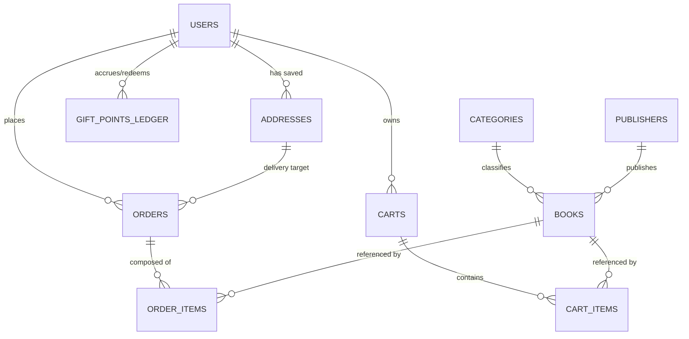

# E-Bookstore Platform — Data Model & Domain Architecture

## 1. Domain Entities & ER Schema

---

## 2. Relational Schema Specification

### `users`
| Column | Type | Constraints | Description |
|---|---|---|---|
| `id` | `BIGSERIAL` | PRIMARY KEY | User unique identifier |
| `email` | `VARCHAR(255)` | UNIQUE, NOT NULL | Login credential |
| `password_hash` | `VARCHAR(255)` | NOT NULL | BCrypt hashed password |
| `full_name` | `VARCHAR(150)` | NOT NULL | Customer name |
| `phone_number` | `VARCHAR(30)` | NULL | Customer phone |
| `gift_points_balance` | `INTEGER` | NOT NULL DEFAULT 100 | Initial signup bonus points |
| `role` | `VARCHAR(50)` | NOT NULL DEFAULT 'ROLE_CUSTOMER' | Security role |
| `created_at` | `TIMESTAMP` | NOT NULL DEFAULT CURRENT_TIMESTAMP | Registration timestamp |

### `addresses`
| Column | Type | Constraints | Description |
|---|---|---|---|
| `id` | `BIGSERIAL` | PRIMARY KEY | Address identifier |
| `user_id` | `BIGINT` | FK -> `users(id)`, NOT NULL | User reference |
| `recipient_name`| `VARCHAR(150)` | NOT NULL | Delivery contact name |
| `street_address`| `VARCHAR(255)` | NOT NULL | Street & building |
| `city` | `VARCHAR(100)` | NOT NULL | City |
| `state` | `VARCHAR(100)` | NOT NULL | State / Province |
| `postal_code` | `VARCHAR(20)` | NOT NULL | Postal / Zip code |
| `country` | `VARCHAR(100)` | NOT NULL | Country |
| `is_default` | `BOOLEAN` | NOT NULL DEFAULT FALSE | Default selection |

### `categories`
| Column | Type | Constraints | Description |
|---|---|---|---|
| `id` | `BIGSERIAL` | PRIMARY KEY | Category identifier |
| `name` | `VARCHAR(100)` | NOT NULL, UNIQUE | Display name (e.g. Cloud & AI, DevOps) |
| `slug` | `VARCHAR(100)` | NOT NULL, UNIQUE | URL slug |
| `description` | `TEXT` | NULL | Overview of genre |

### `publishers` (Brands)
| Column | Type | Constraints | Description |
|---|---|---|---|
| `id` | `BIGSERIAL` | PRIMARY KEY | Publisher identifier |
| `name` | `VARCHAR(150)` | NOT NULL, UNIQUE | Publisher brand (e.g., O'Reilly, Manning, IBM Press) |
| `code` | `VARCHAR(50)` | NOT NULL, UNIQUE | Short identifier code |
| `website` | `VARCHAR(255)` | NULL | Official website URL |

### `books`
| Column | Type | Constraints | Description |
|---|---|---|---|
| `id` | `BIGSERIAL` | PRIMARY KEY | Book ID |
| `title` | `VARCHAR(255)` | NOT NULL | Title of the book |
| `author` | `VARCHAR(255)` | NOT NULL | Author name(s) |
| `isbn` | `VARCHAR(20)` | UNIQUE, NOT NULL | Standard book number |
| `category_id` | `BIGINT` | FK -> `categories(id)` | Classification |
| `publisher_id` | `BIGINT` | FK -> `publishers(id)` | Brand / Publisher |
| `price` | `NUMERIC(10,2)` | NOT NULL | Current sale price |
| `original_price`| `NUMERIC(10,2)` | NOT NULL | MSRP listing price |
| `stock_quantity`| `INTEGER` | NOT NULL DEFAULT 0 | Available inventory |
| `rating` | `NUMERIC(3,2)` | NOT NULL DEFAULT 4.5 | Average customer rating |
| `review_count` | `INTEGER` | NOT NULL DEFAULT 0 | Total reviews count |
| `cover_image_url`| `VARCHAR(500)`| NOT NULL | Book cover image path |
| `description` | `TEXT` | NOT NULL | Synopsis & key takeaways |
| `published_year`| `INTEGER` | NOT NULL | Publication year |
| `page_count` | `INTEGER` | NOT NULL | Total pages |
| `tentative_delivery_days`| `INTEGER`| NOT NULL DEFAULT 2 | Days for shipping estimation |
| `is_featured` | `BOOLEAN` | NOT NULL DEFAULT FALSE | Displayed in hero/bestseller section |

### `carts` & `cart_items`
- `carts`: `id`, `user_id`, `created_at`, `updated_at`.
- `cart_items`: `id`, `cart_id`, `book_id`, `quantity`, `unit_price`, `created_at`.

### `orders` & `order_items`
- `orders`:
  - `id`, `order_number` (`BK-YYYYMMDD-XXXX`), `user_id`, `address_id`
  - `order_status` (`CONFIRMED`, `PROCESSING`, `SHIPPED`, `DELIVERED`, `CANCELLED`)
  - `payment_status` (`PAID`, `REFUNDED`, `FAILED`)
  - `subtotal`, `tax`, `shipping_fee`, `total_amount`
  - `points_redeemed`, `points_discount`, `points_earned`
  - `payment_method` (`CREDIT_CARD`, `DEBIT_CARD`, `UPI`, `NET_BANKING`), `card_last4`
  - `estimated_delivery_date`, `created_at`, `cancelled_at`, `cancel_reason`
- `order_items`:
  - `id`, `order_id`, `book_id`, `book_title`, `book_author`, `cover_image_url`, `quantity`, `unit_price`, `total_price`.

### `gift_points_ledger`
- `id`, `user_id`, `order_id` (nullable), `points`, `type` (`EARNED`, `REDEEMED`, `REFUNDED`), `description`, `created_at`.

---

## 3. Core Business Rules

1. **48-Hour Order Cancellation Policy**:
   - Customers can cancel an order if `order_status == 'CONFIRMED'` and `Duration.between(order.createdAt, now).toHours() < 48`.
   - On cancellation:
     - `order_status` transitions to `CANCELLED`.
     - `payment_status` transitions to `REFUNDED`.
     - Book stock inventory is restored (`book.stock += item.quantity`).
     - Redeemed gift points are credited back to the customer's wallet ledger.
     - Earned points from that order are revoked.

2. **Loyalty & Gift Points Engine**:
   - Every purchase earns 1 point for every $10 spent (`Math.floor(totalAmount / 10)`).
   - Points can be redeemed at checkout at the rate of **10 points = $1.00 USD discount**.
   - Maximum points redeemable per order cannot exceed the cart subtotal.

3. **Recommendation Engine**:
   - **Catalog Detail**: "Related Products" queries other books in the same category and publisher.
   - **Cart & Order History**: Personalized recommendations query categories and authors from previous completed orders of the customer, prioritizing top-rated unpurchased books.

4. **Buy It Again (1-Click Reorder)**:
   - Takes all line items from a previous order and loads them back into the active shopping cart with current stock checks.
